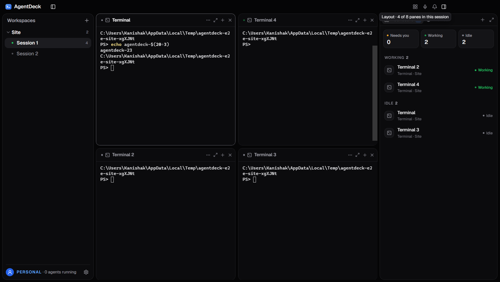
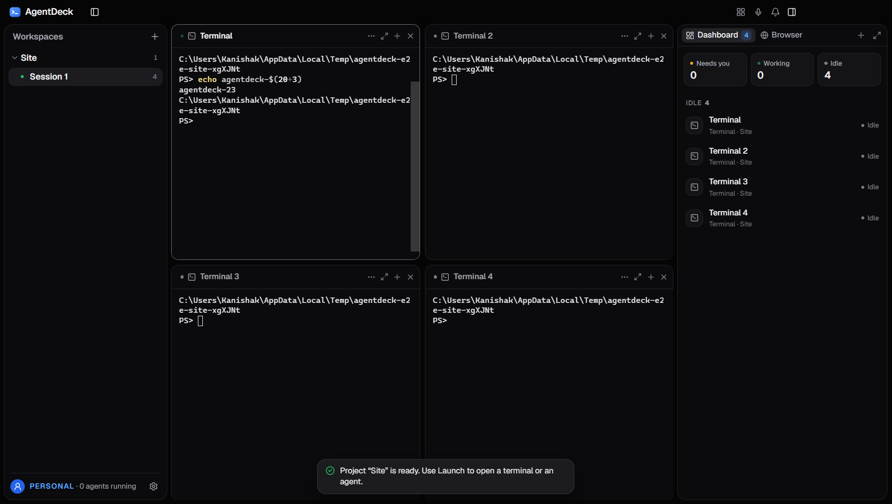
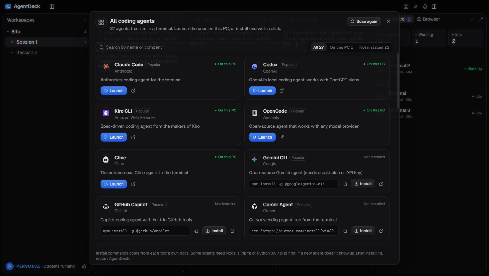
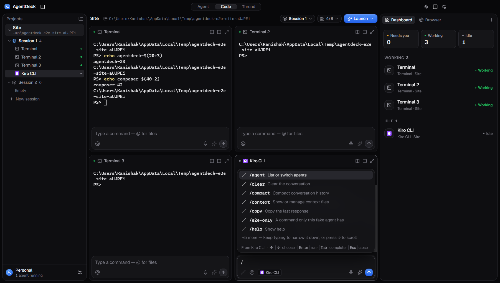
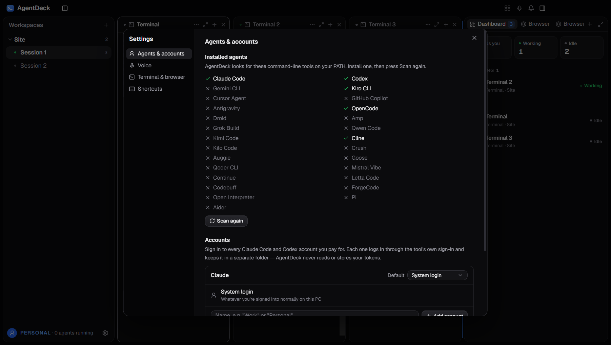

# AgentDeck ⚡

[](LICENSE)
[](https://github.com/kanishakusingai/agentdeck)
[](https://www.electronjs.org/)
[](https://react.dev/)

> **AgentDeck** is an open-source, personal desktop workspace and super-app for AI coding agents (inspired by [BridgeMind](https://www.bridgemind.ai/)). It multiplexes multiple agent terminals, provides push-to-talk voice dictation with local Whisper AI, and lets you orchestrate CLI agents in a unified, dockable layout.

---

## 📸 App Preview

### 1. Multi-Agent Terminal Canvas
> Arrange, dock, and run multiple AI agents (Claude Code, OpenAI Codex, OpenCode, Kiro CLI) side-by-side with full workspace persistence.



---

### 2. Intelligent Tiled Layouts
> Split down, tab across, or tile panes evenly to maximize screen efficiency during multi-agent workflows.



---

### 3. Agent Launcher
> Quickly start fresh agent sessions with predefined teammate personas, commands, and workspace boundaries.



---

### 4. Dedicated Terminal Composers & Slash Commands
> Each terminal pane has its own multi-line message composer with interactive `/` slash command discovery and `@` file mentions.



---

### 5. Multi-Account Settings & Customization
> Seamlessly configure provider accounts, terminal themes, font sizes, custom shortcuts, and Whisper voice dictation keys.



---

## ✨ Key Features

- **Multi-Agent Dockview Canvas**: Dock, split, tab, and arrange multiple terminal panes using `dockview-react` and `xterm.js`.
- **Works with Any Coding Agent**: Native support for **Claude Code**, **OpenAI Codex**, **OpenCode**, **Kiro CLI**, PowerShell, and Bash.
- **Dedicated Message Composers**: Each terminal pane features its own input box supporting slash commands, file mentions, and multi-line prompts.
- **Push-to-Talk Voice Dictation**: Hands-free voice coding powered by a local HuggingFace Whisper model running directly on your machine.
- **Workspaces & Sessions Management**: Left sidebar lists your active workspaces and sessions with real-time status dots and pane counts.
- **In-App Browser Dashboard**: Live preview dashboard with desktop, tablet, and mobile viewport responsive modes.
- **Full-Text Thread Search**: Quickly search across all transcripts and conversation histories with instant filtering.
- **Native Windows Controls**: Standard native minimize, maximize, and close title bar controls with custom blue/zinc dark theme styling.
- **100% Local & Private**: No cloud telemetry or third-party servers required. Your API keys and source code stay on your computer.

---

## 🛠️ Tech Stack

- **Framework**: [Electron](https://www.electronjs.org/) (v44) with [electron-vite](https://electron-vite.org/)
- **Frontend**: [React 19](https://react.dev/), [TypeScript](https://www.typescriptlang.org/), [Tailwind CSS v4](https://tailwindcss.com/)
- **Terminal & Layout**: `@xterm/xterm`, `@lydell/node-pty`, `dockview-react`
- **Voice / AI**: `@huggingface/transformers` (local Whisper speech-to-text)
- **Testing**: [Vitest](https://vitest.dev/) (unit tests) & [Playwright](https://playwright.dev/) (end-to-end Electron tests)

---

## 🚀 Getting Started

### Prerequisites

- [Node.js](https://nodejs.org/) (v20+ or v24 recommended)
- [Git](https://git-scm.com/)

### Installation

1. **Clone the repository**:
   ```bash
   git clone https://github.com/kanishakusingai/agentdeck.git
   cd agentdeck
   ```

2. **Install dependencies**:
   ```bash
   npm install
   ```

3. **Start in development mode**:
   ```bash
   npm run dev
   ```

---

## 📦 Scripts

| Command | Description |
| :--- | :--- |
| `npm run dev` | Launch the app in development with live-reloading |
| `npm test` | Run Vitest unit tests |
| `npm run typecheck` | Run TypeScript checks across main, preload, and renderer processes |
| `npm run test:e2e` | Run Playwright end-to-end test suite |
| `npm run dist` | Package and build the Windows installer executable (`.exe`) |

---

## 🏗️ Architecture

```
agentdeck/
├── src/
│   ├── main/           # Electron main process (PTYs, process runner, store, voice worker)
│   ├── preload/        # Secure typed contextBridge IPC bridge
│   ├── renderer/       # React 19 UI (dockview canvas, terminal panes, composers, sidebar)
│   └── shared/         # Shared TypeScript interfaces, types, and schemas
├── e2e/                # Playwright end-to-end Electron tests
└── docs/               # Specifications and screenshots
```

---

## 🤝 Contributing

Contributions, issues, and feature requests are welcome! Feel free to check the [issues page](https://github.com/kanishakusingai/agentdeck/issues).

---

## 📄 License

This project is licensed under the [MIT License](LICENSE) — free for personal and commercial use.
